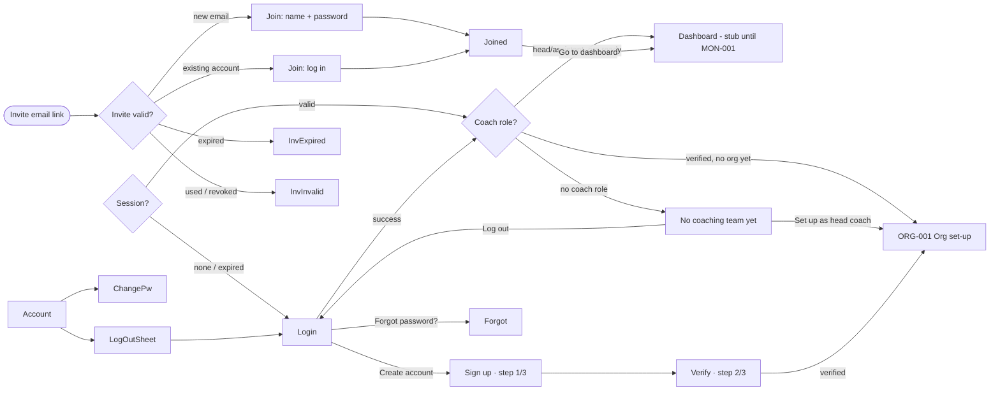

# CF01 — Coach sign-in, sign-up, invite, password: UI design (LOCKED)

| | |
|---|---|
| **App** | FitSphere Coach (Expo, iOS + Android) |
| **Status** | UI locked by Mudit, 2026-11-03; changes approved the same day (below) |
| **Spec IDs** | CAUTH-001, CAUTH-002, CAUTH-003, CAUTH-004, CAUTH-005, CAUTH-006 (`coach-spec.md` v0.3) |
| **Depends on** | CF00 (app shell, theme from `docs/design/design-system.md`, shared Supabase client) |
| **Design source** | "FitSphere Coach Screens" canvas in Claude: boards *CAUTH-001 · Log in* … *CAUTH-004 · Log out* |
| **Put at** | `docs/features/CF01-auth/ui-design.md` in the coach repo |

All visual values come from `docs/design/design-system.md` (same file as the user app). Copy in quotes is exact. UPPERCASE text is rendered by the style (Barlow Condensed uppercase); write it in sentence case in code.

## 0. Changes approved 2026-11-03 (these win over the sections below)
- **Sign up:** heading "START" / "COACHING"; sub "Create your coach account. Next you'll verify your email, then choose Coach or Head Coach."; an **"I am 18 or older"** checkbox above the terms (the trainee app's exact text), with the hint *Tick "I am 18 or older" to continue.* until ticked. Anyone can sign up as a coach; step 3 is choosing Coach or Head Coach (CF02).
- **Verify (C-D8):** the email has a **link, not a code** (the shared Supabase email cannot change, C-D7). The screen says "VERIFY YOUR / EMAIL", asks the coach to tap the link (it opens FitSphere Coach), offers OPEN EMAIL APP, RESEND LINK (60 s countdown) and "Verified on another phone? LOG IN". No code boxes. The link opens a "YOU'RE / IN" screen (step 2 of 3 · done) with CONTINUE.
- **Coaching is off** (was "No coaching team yet"): main button SWITCH ON COACHING (→ CF02); a head coach's invite shows here as a card (with CF03).
- **Accept invite:** "Coach" instead of "Assistant coach"; built with CF03, when invites can be sent.
- **Account setup:** the coach's account is created exactly as the trainee app creates one (confirmed email, 18+, the Personal Training User role), plus the coach's name and coach terms in schema `coach`.

---

## 1. Decisions taken in design (record in `coach-spec.md` §16)

| Topic | Decision |
|---|---|
| CQ-01 | Self-serve head coach sign-up (CAUTH-006). |
| CQ-02 | Coach invites expire after **7 days**, single use. |
| App identity | Wordmark "FIT" + "SPHERE" (accent) followed by a **COACH tag**: Barlow Condensed 11/800, letter-spacing 2, `accent` text, 1.5 px `accent` border, radius 2. On every auth screen. |
| Email verification | **Required** for head coaches (no "Do this later"). 6-digit code + link, 60 s resend. Invited coaches skip it: the invite link proves the email. |
| Sign-up steps | 3: account → verify → organisation (ORG-001, next feature). |
| Existing FitSphere account | Logging in to the coach app without a coach role shows "No coaching team yet": set up as head coach with the same login, or ask for an invite. |
| Password rules | Same as the user app: 8+ characters, a number and a letter; 5 failed logins → 5-minute lockout; reset links single-use, 30 minutes. |
| Shared login | Password screens tell the coach the password is for **both FitSphere apps**. |
| Terms | Sign-up and invite acceptance require Terms, Privacy Policy **and Coach data terms**; acceptance stored with timestamp and version. |

---

## 2. Flow

Unverified head coach (closed the app on Verify): every log in returns to Verify until done (CAUTH-006 AC3/AC5).

---

## 3. Shared layout (Log in, No coaching team, Sign up, Verify, Invite, Forgot)

Identical to user-app F01 §3: background `bg`; padding 16 top, 20 sides, 28 bottom (plus safe areas); signature stripe triangle top-right; 44 px top bar with back chevron where there's a back step and the **wordmark + COACH tag** centred; heading block (optional step label in `accent`, BC 14/700, +2; `display` heading over two lines, **second line in `accent`**; body sub-text in `inkMuted`); fields 18 px apart; primary button and secondary link pinned to the bottom above the keyboard. Return key moves to the next field; on the last field it submits.

Screens taller than the phone (Sign up, Invite) scroll; the button block stays at the end of the content.

---

## 4. Screens

### 4.1 Log in (CAUTH-001, CAUTH-004)
**Top → bottom**
1. Wordmark + COACH (no back)
2. [session-expired banner, info] "You were signed out. Log in to pick up where you left off."
3. Heading "WELCOME BACK," / "COACH"
4. Sub: "Log in to see your trainees and what they logged today."
5. [error banner]
6. **Email**
7. **Password** label row with "FORGOT PASSWORD?" link on the right · field with eye
8. Primary "LOG IN →"
9. "New coach? **CREATE ACCOUNT**"
10. Small, centred, `inkMuted`: "Invited to a team? Open the link in your invite email."

| State | What shows |
|---|---|
| ready | Default |
| loading | Spinner in button; fields 60 % opacity |
| wrong details | Error banner: "Email or password is incorrect. Check both and try again." |
| too many attempts | Error banner: "Too many attempts. Try again in 5 minutes, or reset your password."; button disabled |
| session expired | Info banner above the heading |

**Behaviour:** success → route by role (§2).

### 4.2 No coaching team yet (CAUTH-001 AC4, CAUTH-005)
Shown after a successful log in when the account has no active coach membership.
1. Wordmark + COACH
2. 72 px `accentTint` tile with Lucide `users` icon
3. Heading "NO COACHING" / "TEAM YET"
4. Body: "You're logged in as **{email}**. This account uses the FitSphere app, but it isn't part of a coaching team."
5. List card, two rows divided by a 1 px border:
   - `crown` icon (accent) · "Starting your own team?" · "Set up an organisation as head coach. You keep this login for both apps."
   - `mail` icon (accent) · "Joining someone's team?" · "Ask your head coach to invite this email, then open the link in the invite."
6. Primary "SET UP AS HEAD COACH →" (→ ORG-001; if the email isn't verified, Verify first)
7. Secondary "LOG OUT"

| State | What shows |
|---|---|
| default | As above |
| setting up | Spinner in the primary button; both buttons disabled |

### 4.3 Sign up (CAUTH-006)
1. Back (→ Log in) · wordmark + COACH
2. "STEP 1 OF 3"
3. Heading "START YOUR" / "COACHING TEAM"
4. Sub: "Create your head coach account. Next you'll verify your email and set up your organisation."
5. **Full name** (placeholder "Asha Rao", autocomplete name) + hint "Trainees see this name on plans and targets you set."
6. **Email** (placeholder "you@yourgym.com")
7. **Password** + eye → 3-segment strength bar → rules: "At least 8 characters" · "Includes a number" · "Includes a letter"
8. Checkbox: "I agree to the **Terms**, **Privacy Policy** and **Coach data terms**"
9. Primary "CREATE ACCOUNT →"
10. "Already have an account? **LOG IN**"

| State | What shows |
|---|---|
| empty | Button disabled; rules muted; segments empty |
| typing | Password border `accent`; met rules `success` with tick, one segment per met rule; button disabled until name, valid email, all rules and the box are done |
| ready | Button enabled |
| submitting | Spinner; fields 60 % |
| email can't be used | Email border `danger`; "Can't use this email. **LOG IN** or **RESET PASSWORD**". Never confirms the account exists. |
| network error | Error banner above the button: "Couldn't reach FitSphere. Check your connection and try again." |

Name: 2–60 characters, trimmed. On success: create the account, store the name and Terms/Coach data terms acceptance (timestamp + version), send the code, go to Verify.

### 4.4 Verify email (CAUTH-006)
1. Back (→ Sign up) · wordmark + COACH
2. "STEP 2 OF 3"
3. Heading "VERIFY YOUR" / "EMAIL"
4. "Enter the 6-digit code we sent to **{email}**. **CHANGE**"
5. 6 code boxes · [error] · "Didn't get it? Resend in **0:42** · or tap the link in the email"
6. Info banner (shield icon): "Coaches see trainee data, so your email must be verified before you continue."
7. Primary "VERIFY →" (disabled until 6 digits)

| State | What shows |
|---|---|
| typing | Filled digits; next box `accent` border |
| wrong code | All boxes `danger`; "That code didn't match. Check the latest email and try again." |
| verified | No back. 80 px `success` tile with tick, "STEP 2 OF 3 · DONE", "YOU'RE" / "IN", "Email verified. Last step: name your organisation and set its time zone.", primary "SET UP MY ORGANISATION →" |

Paste fills all boxes; auto-submit on the 6th digit. "Change" returns to Sign up with fields filled.

### 4.5 Accept coach invite (CAUTH-002)
Opened from the invite email link (deep link with the invite token). The token is checked first.

**Valid invite, shared top:** wordmark + COACH (no back) → "COACH INVITE" (step style) → "JOIN" / "{ORG NAME}" → invite card (`surface`, 1 px border): org initials tile (44 px, radius 8, `primary`) + org name + "Invited by {head coach name} · Head coach"; row "ROLE · Assistant coach"; row "EMAIL · 🔒 {email}" (lock icon, labelled "From your invite"; not editable).

| State | Rest of screen |
|---|---|
| new account | **Your name** (pre-filled from the invite, editable) · **Create a password** + strength bar + rule summary · Terms checkbox (as Sign up) · primary "ACCEPT AND JOIN →" · "Not for you? Ignore this invite. It expires on **{date}**." |
| existing account | "This email already has a FitSphere account. Log in to accept. You'll use the same login in both FitSphere apps." · **Password** with "FORGOT PASSWORD?" · primary "LOG IN AND JOIN →" · same expiry line |
| expired | Clock tile · "INVITE" / "EXPIRED" · "Coach invites work for 7 days. Ask **{head coach}** at {org} to send you a new one." · secondary "GO TO LOG IN" |
| no longer valid | Ban tile · "INVITE NO" / "LONGER VALID" · "This invite was cancelled or has already been used. If you've already joined, log in. If not, ask your head coach for a new invite." · primary "LOG IN" |
| joined | Success tile · "WELCOME TO" / "{ORG NAME}" · "You're an assistant coach at {org}. Your head coach will assign trainees to you, or you can invite your own." · primary "GO TO DASHBOARD →" |

Wrong password in the existing-account state uses the generic Log in error banner. Joining creates the coach membership and marks the invite used, in one server call.

### 4.6 Forgot password (CAUTH-003): one screen, 4 steps
| Step | Heading | Content | Actions |
|---|---|---|---|
| request | "RESET YOUR" / "PASSWORD" | "Enter the email you use for FitSphere Coach. We'll send a reset link." · Email | "SEND RESET LINK →"; "BACK TO LOG IN" |
| sent | "CHECK YOUR" / "INBOX" | Mail tile. "If an account exists for **{email}**, a reset link is on its way. It works once and expires in 30 minutes." · "Nothing yet? Check spam, or resend in **0:42**" | "OPEN EMAIL APP"; secondary "RESEND LINK" (disabled during countdown) |
| new password | "SET A NEW" / "PASSWORD" | "This changes your password in both FitSphere apps. You'll be signed out on your other devices." · New password + strength + "Strong password: 8+ characters, a number and a letter" · Confirm password | "SAVE AND LOG IN" |
| link expired | "LINK" / "EXPIRED" | Clock tile. "Reset links work once and only for 30 minutes. Request a new one and use it straight away." | "SEND A NEW LINK" |

The reset link opens the **coach** app (its own deep-link scheme).

### 4.7 Change password (CAUTH-004), pushed from Account
Back "ACCOUNT" (muted) → "CHANGE PASSWORD" (`screenTitle`) → "This is the password for both FitSphere apps. You'll stay signed in here; other devices will be signed out." → [success banner] → **Current password** → **New password** + strength + "8+ characters, a number and a letter" → **Confirm new password** → primary "UPDATE PASSWORD" → "FORGOT CURRENT PASSWORD?".

| State | What shows |
|---|---|
| ready | Enabled when all valid and matching |
| wrong current | Current `danger` + "Current password is incorrect." |
| mismatch | Confirm `danger` + "Passwords don't match."; button disabled |
| updated | Success banner "Password updated. Other devices are signed out."; fields cleared |

### 4.8 Log out (CAUTH-004): bottom sheet over Account
Account (stub for CF01; full screen is CACC-001): "ACCOUNT" title → profile card (52 px avatar initial, name, "{Role} · {Org}", email) → "SECURITY" card: "Change password" (chevron) · "Log out" (`accent`, 600) → version line.
**Sheet:** handle → 56 px tile with log-out icon → "LOG OUT?" → "Your team and trainee data stay on your account. You'll need your email and password to log back in." → primary "LOG OUT" → secondary "STAY LOGGED IN". Scrim tap or swipe down cancels.
**Behaviour:** end the session on the server, clear tokens, query cache and cached trainee data, go to Log in.

---

## 5. Accessibility
Same rules as user-app F01 §5: visible labels tied to inputs; eye button "Show password" / "Hide password"; errors announced next to the cause; code boxes announced as one field ("Verification code, 3 of 6 digits entered"); AA contrast in both themes; disabled state exposed; text scales and headings wrap. The COACH tag is read as part of the app name ("FitSphere Coach").

## 6. Implementation notes (Expo + Supabase, shared project with the user app)
- Same Supabase project and Auth as the user app (one account per email). Coach access comes from a `coach_memberships` row, never from a flag the client can set.
- **Role routing after log in:** read the user's active membership (RLS: own rows only). None → "No coaching team yet". Head coach with no org → ORG-001.
- **Sign up:** `signUp({ email, password, options: { data: { full_name }, emailRedirectTo: <coach deep link> } })`. 6-digit OTP via the shared email template. Store Terms + Coach data terms acceptance in a `legal_acceptances` row (user, document, version, accepted_at).
- **Verify:** `verifyOtp({ email, token, type: 'signup' })`; resend `resend({ type: 'signup', email })`. Route guard blocks ORG set-up until `email_confirmed_at` is set.
- **Invites:** `coach_invites` (org, email, role, token hash, expires_at = now + 7 days, status). Opening the link calls an Edge Function / RPC `get_invite(token)` that returns only org name, inviter name, role, email, status and expiry. Accept = RPC `accept_coach_invite(token)` run as the signed-in user: checks token, expiry, status and that the user's email equals the invite email, then creates the membership and marks the invite used, in one transaction. New-account path: sign up with the invite email, then accept; the email counts as verified because the invite token was delivered to it (confirm via the invite flow server-side).
- **Log in / lockout / forgot / change password / log out:** identical calls to user-app F01 §6 (`signInWithPassword`, `resetPasswordForEmail` with the coach app's redirect, `updateUser`, `signOut({ scope: 'others' })`, `signOut()`).
- **Deep links:** coach app scheme (e.g. `fitspherecoach://`) for reset and invite links; universal links later.
- Session in `expo-secure-store`, same as the user app.

## 7. Demo script (90 s)
1. Open FitSphere Coach → "Create account" → fill name, email, password (rules turn green), tick terms → Create.
2. Enter the 6-digit code → "You're in" → (org set-up stub).
3. Log out → log in with a wrong password → generic error → right password → org set-up stub.
4. Log in with a user-app-only account → "No coaching team yet" → Log out.
5. Open a test invite link for a new email → set name and password → "Welcome to Iron Gym".
6. Open an expired invite link → "Invite expired".
7. Account → Change password → updated banner. Log out → Forgot password → Check your inbox.

## 8. Out of scope for CF01
Organisation set-up screens (ORG-001, next), sending invites (TEAM-002), dashboard (MON-001), full Account screen (CACC-001), social sign-in, phone OTP.
