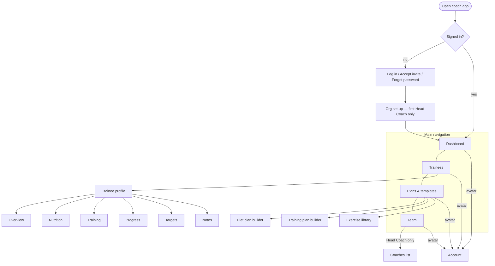

# FitSphere Coach — Product Specification (MVP)

| | |
|---|---|
| **Version** | 0.3 (Draft) — CQ-04, CQ-01, CQ-37, CQ-38 decided |
| **App name** | FitSphere Coach |
| **Date** | 2026-11-03 |
| **Sources** | `spec.md` v0.2 §17 *Deferred* (ROLE-*, HC-*, COACH-*); `FitSphere_Requirements.xlsx` (*User Type*, *Coach-Assigned Targets and Plans*); locked user-app UI docs (F00–F06); `design-system.md` |
| **MVP scope** | Head Coach, Assistant Coach, and the link between a coach and a trainee (the PTU in the user app). |
| **Shared with user app** | Same database (Supabase Postgres + Auth + Realtime). Data written here appears in the user app in real time, and vice versa. |
| **Status** | Awaiting prioritisation |

---

## 0. How to use this spec

Same conventions as `spec.md`:

- Every requirement has a stable ID. Coach-app IDs start with **C** (e.g. `CTRN-003`) so they never collide with user-app IDs.
- **Priority** is blank everywhere (P0 / P1 / P2 / Won't). §2 lists every ID in one place.
- **Source:** `Deferred` = came from `spec.md` §17; `XLSX` = requirements sheet; `Derived` = needed to make the coach features work; `Cross` = needed because both apps share one database.
- Anything undecided is in §16 *Open questions* as `→ CQ-nn`. It is not guessed.
- **§13 Cross-app requirements** lists what the *user app team* must build or change. Hand that section to them.

### Terms

| Term | Meaning |
|---|---|
| **Organisation (Org)** | A coaching business or gym. One Head Coach owns it; all coaches and trainees belong to it. |
| **Head Coach (HC)** | Owner of an Org. Manages assistant coaches and can see and act on every trainee in the Org. |
| **Assistant Coach (AC)** | A coach added by the Head Coach. Sees and acts only on trainees assigned to them. (`spec.md` called this "Coach".) |
| **Coach** | Either HC or AC, when a rule applies to both. |
| **Trainee** | A user-app user (PTU) linked to an Org and assigned to a coach. |
| **Link** | The consented connection between a trainee and an Org. Without an active link, a coach sees nothing. |
| **Assigned coach** | The coach responsible for a trainee. Exactly one per trainee. |
| **Plan** | A diet plan or a training plan. Has a draft and published versions. Trainees only ever see published versions. |
| **Template** | A reusable plan not tied to a trainee. Assigning it creates a copy for the trainee. |
| **Adherence** | How closely a trainee is following targets: meals logged, calories/protein vs target, workouts done vs planned. |
| **Flag** | An automatic alert about a trainee that needs a coach's attention (e.g. "No meals logged for 3 days"). |

### 0.1 Roles at a glance

| Can… | Head Coach | Assistant Coach | Trainee (user app) |
|---|---|---|---|
| Manage Org settings and branding | ✓ | – | – |
| Add / deactivate assistant coaches | ✓ | – | – |
| Invite and add trainees | ✓ | ✓ (assigned to self) | – |
| Reassign trainees between coaches | ✓ | – | – |
| See a trainee's logs and progress | All trainees | Assigned only | Own only |
| Set targets, diet plan, training plan | All trainees | Assigned only | – (→ CQ-04) |
| Create templates | ✓ (Org-wide) | ✓ (own; share → CQ-10) | – |
| Write private coach notes | ✓ | ✓ | Never sees them |
| Accept / end the link | – | – | ✓ |

---

## 1. Product overview

The Coach app lets a Head Coach run a coaching team and lets every coach manage their trainees: set their targets, build their diet and training plans, and watch what they log in the user app. Both apps read and write the same database, so a plan a coach publishes appears in the trainee's Nutrition › Diet plan and Training tabs within seconds, and a meal the trainee logs appears on the coach's dashboard just as fast.

### 1.1 Screen map



### 1.2 How the two apps share data

```mermaid
flowchart LR
    subgraph UserApp[User app]
      U1[Logs meals, weight, steps, sleep, workouts, measurements]
      U2[Shows targets, diet plan, training plan]
      U3[Accepts / ends coach link]
    end
    subgraph DB[(Shared Supabase DB + Realtime)]
      T1[Trainee-owned data]
      T2[Coach-authored data: targets, plans, comments]
      T3[Org, coaches, links, assignments]
    end
    subgraph CoachApp[Coach app]
      C1[Reads trainee data]
      C2[Writes targets, plans, comments]
      C3[Manages Org, coaches, invites]
    end
    U1 --> T1 --> C1
    C2 --> T2 --> U2
    U3 --> T3
    C3 --> T3
```

**Ownership rule:** trainees own what they log; coaches never edit trainee logs (→ CQ-05). Coaches own targets, plans and comments they author; trainees see them read-only.

**Precedence rule (decided, CQ-04):** coach updates and inputs **always take priority** over the trainee's own updates and edits. Wherever a coach and a trainee can both set the same value (targets, plans, and anything added later), the coach's value is the one in force, whichever was saved last. A trainee edit can never overwrite or replace a coach-set value. This is enforced on the server.

---

## 2. Priority summary

| ID | Title | Area | Priority |
|---|---|---|---|
| CAUTH-001 | Coach log in | Auth | |
| CAUTH-002 | Accept coach invite | Auth | |
| CAUTH-003 | Forgot / reset password | Auth | |
| CAUTH-004 | Session, log out, change password | Auth | |
| CAUTH-005 | One login, coach and/or trainee | Auth | |
| CAUTH-006 | Head Coach self-serve sign-up and email verification | Auth | |
| ORG-001 | Create an Organisation (first Head Coach) | Org | |
| ORG-002 | Org profile and branding | Org | |
| ORG-003 | Trainee capacity / plan limits | Org | |
| TEAM-001 | Coaches list | Team | |
| TEAM-002 | Invite an assistant coach | Team | |
| TEAM-003 | Edit coach details and permissions | Team | |
| TEAM-004 | Deactivate / remove a coach | Team | |
| TEAM-005 | Coach workload view | Team | |
| TEAM-006 | Transfer Head Coach ownership | Team | |
| LINK-001 | Invite a trainee by email or code | Trainee link | |
| LINK-002 | Trainee accepts link (consent) | Trainee link | |
| LINK-003 | Pending invites list | Trainee link | |
| LINK-004 | End a link (coach or trainee) | Trainee link | |
| LINK-005 | Reassign trainee to another coach | Trainee link | |
| LINK-006 | Data visible after linking | Trainee link | |
| TRNE-001 | Trainee list | Trainees | |
| TRNE-002 | Search, filter and sort trainees | Trainees | |
| TRNE-003 | Trainee status and tags | Trainees | |
| TRNE-004 | Archive trainee | Trainees | |
| TPRO-001 | Trainee profile header | Trainee profile | |
| TPRO-002 | Overview tab (today at a glance) | Trainee profile | |
| TPRO-003 | Nutrition tab: daily food log | Trainee profile | |
| TPRO-004 | Training tab: workout log | Trainee profile | |
| TPRO-005 | Progress tab | Trainee profile | |
| TPRO-006 | Body metrics and measurements | Trainee profile | |
| TPRO-007 | Date navigation in trainee views | Trainee profile | |
| CTGT-001 | Set targets for a trainee | Targets | |
| CTGT-002 | Target history and effective dates | Targets | |
| CTGT-003 | Start from calculated targets | Targets | |
| CTGT-004 | Coach targets take priority over trainee edits | Targets | |
| CDIET-001 | Diet plan builder | Diet plans | |
| CDIET-002 | Meal slots and up to 3 options | Diet plans | |
| CDIET-003 | Ingredients from food database | Diet plans | |
| CDIET-004 | Protein source first | Diet plans | |
| CDIET-005 | Live totals vs targets | Diet plans | |
| CDIET-006 | Draft, publish and versions | Diet plans | |
| CDIET-007 | Coach guidance notes on a plan | Diet plans | |
| CTRN-001 | Training plan builder | Training plans | |
| CTRN-002 | Exercises with sets, reps, rest, notes | Training plans | |
| CTRN-003 | Plan schedule (days / weeks) | Training plans | |
| CTRN-004 | Draft, publish and versions | Training plans | |
| CTRN-005 | Progression across weeks | Training plans | |
| TPL-001 | Plan templates library | Templates | |
| TPL-002 | Assign template to trainee(s) | Templates | |
| TPL-003 | Save trainee plan as template | Templates | |
| EXL-001 | Exercise library browse and search | Exercise library | |
| EXL-002 | Custom exercises with how-to | Exercise library | |
| MON-001 | Coach dashboard | Monitoring | |
| MON-002 | Adherence scores | Monitoring | |
| MON-003 | Automatic flags | Monitoring | |
| MON-004 | Activity feed (real time) | Monitoring | |
| MON-005 | Weekly check-in review | Monitoring | |
| COMM-001 | Private coach notes | Communication | |
| COMM-002 | Comment on a meal, workout or day | Communication | |
| COMM-003 | Plan-published notification to trainee | Communication | |
| COMM-004 | Messaging (chat) | Communication | |
| RPT-001 | Trainee progress report | Reports | |
| RPT-002 | Export report (PDF / CSV) | Reports | |
| RPT-003 | Team report (Head Coach) | Reports | |
| CACC-001 | Coach account and settings | Account | |
| AUD-001 | Audit log | Audit | |
| CROSS-001 … CROSS-011 | User-app changes (§13) | Cross-app | |
| CNFR-001 … CNFR-012 | Non-functional (§14) | Cross-cutting | |

---

## 3. Authentication

### CAUTH-001: Coach log in
- **Priority:**
- **Source:** Deferred (ROLE-*); Derived
- **Acceptance criteria:**
  - [ ] AC1: Given a coach account, when the coach enters a valid email and password, then they land on the Dashboard.
  - [ ] AC2: Invalid credentials show one generic error (same rule as AUTH-002).
  - [ ] AC3: Rate limit and lockout match the user app (5 failures → 5-minute lockout).
  - [ ] AC4: Given a user with no coach role logs in here, then they see "No coaching team yet" with two ways forward: set up as head coach (CAUTH-006 → ORG-001, same login) or ask a head coach for an invite. They see no coach data.
- **Notes:** CQ-01 decided: self-serve sign-up (CAUTH-006).

### CAUTH-002: Accept coach invite
- **Priority:**
- **Source:** Derived (TEAM-002)
- **Acceptance criteria:**
  - [ ] AC1: Given an invite email, when the invitee opens the link, then they see the Org name and the inviting Head Coach, and can create a password (or log in if the email already has an account — CAUTH-005).
  - [ ] AC2: Invites are single-use and expire after N days. → CQ-02
  - [ ] AC3: An expired or revoked invite shows a clear message and asks the Head Coach to re-send.

### CAUTH-003: Forgot / reset password
- **Priority:**
- **Source:** Derived
- **Acceptance criteria:**
  - [ ] AC1: Same behaviour and wording rules as AUTH-003 (neutral confirmation, single-use link, 30-minute expiry, all other sessions signed out).

### CAUTH-004: Session, log out, change password
- **Priority:**
- **Source:** Derived
- **Acceptance criteria:**
  - [ ] AC1: Same rules as AUTH-004, ACCT-007, ACCT-008.
  - [ ] AC2: On the web, an idle session expires after N hours of inactivity. → CQ-03

### CAUTH-005: One login, coach and/or trainee
- **Priority:**
- **Source:** Cross
- **Context:** Both apps share Supabase Auth, so one email = one account. A coach may also train with the app themselves.
- **Acceptance criteria:**
  - [ ] AC1: One auth user can hold a coach role in one Org and also be a trainee (in the user app). Roles are stored separately from the auth user.
  - [ ] AC2: A coach cannot be linked as a trainee of their own Org. → CQ-06
  - [ ] AC3: Password changes apply to both apps.

### CAUTH-006: Head Coach self-serve sign-up and email verification
- **Priority:**
- **Source:** CQ-01 decided 2026-11-03 (self-serve)
- **Acceptance criteria:**
  - [ ] AC1: Anyone can create a head coach account with full name, email and password (same password rules as AUTH-001), accepting the Terms, Privacy Policy and Coach data terms (acceptance stored with a timestamp).
  - [ ] AC2: Sign-up is 3 steps: account → verify email → set up organisation (ORG-001).
  - [ ] AC3: Email verification (6-digit code, link as fallback, 60 s resend) is **required** before the organisation can be created; there is no "Do this later" for coaches.
  - [ ] AC4: An email already registered shows the same neutral error as AUTH-001; an existing FitSphere user logs in instead and continues from "No coaching team yet" (CAUTH-001 AC4).
  - [ ] AC5: An account with a verified email but no organisation is sent to organisation set-up on every log in until it's done.

---

## 4. Organisation

### ORG-001: Create an Organisation
- **Priority:**
- **Source:** Deferred (HC-*)
- **Acceptance criteria:**
  - [ ] AC1: The first Head Coach creates an Org with a name, country and time zone.
  - [ ] AC2: The creator becomes its Head Coach. An Org always has exactly one Head Coach.
  - [ ] AC3: Org time zone is the default for coaches; each trainee's data is still shown in the **trainee's** time zone (DATE-004).
- **Notes:** Who may create an Org (anyone, or FitSphere staff only) → CQ-01.

### ORG-002: Org profile and branding
- **Priority:**
- **Source:** Derived
- **Acceptance criteria:**
  - [ ] AC1: Head Coach can edit the Org name, logo and contact email.
  - [ ] AC2: Trainees see the Org name (and logo → CQ-07) where coach-set data appears ("Set by Coach Asha · Iron Gym").

### ORG-003: Trainee capacity / plan limits
- **Priority:**
- **Source:** Derived
- **Acceptance criteria:**
  - [ ] AC1: The Org has a maximum number of active trainees and coaches. Inviting beyond it is blocked with a clear message. → CQ-08 (payments / subscription)

---

## 5. Team (Head Coach only)

### TEAM-001: Coaches list
- **Priority:**
- **Source:** Deferred (HC-*)
- **Acceptance criteria:**
  - [ ] AC1: Lists all coaches with name, email, role, status (Active / Invited / Deactivated) and number of active trainees.
  - [ ] AC2: Search by name or email.
  - [ ] AC3: Hidden from Assistant Coaches.

### TEAM-002: Invite an assistant coach
- **Priority:**
- **Source:** Deferred (HC-* "CRUD Coaches")
- **Acceptance criteria:**
  - [ ] AC1: Head Coach enters name and email; an invite email is sent (CAUTH-002).
  - [ ] AC2: The coach appears as "Invited" until they accept. The invite can be re-sent or revoked.
  - [ ] AC3: An email that is already a coach in another Org cannot be invited. → CQ-06

### TEAM-003: Edit coach details and permissions
- **Priority:**
- **Source:** Deferred
- **Acceptance criteria:**
  - [ ] AC1: Head Coach can edit an assistant coach's display name.
  - [ ] AC2: Optional permissions per assistant coach: *can create Org templates*, *can invite trainees*. Defaults: both on. → CQ-10

### TEAM-004: Deactivate / remove a coach
- **Priority:**
- **Source:** Deferred
- **Acceptance criteria:**
  - [ ] AC1: Deactivating a coach requires choosing where their trainees go (another coach or the Head Coach). The action is blocked until every trainee has a new coach.
  - [ ] AC2: A deactivated coach is signed out everywhere and loses all access immediately.
  - [ ] AC3: Plans, targets and notes they authored stay, still showing them as the author.
  - [ ] AC4: A deactivated coach can be reactivated.

### TEAM-005: Coach workload view
- **Priority:**
- **Source:** Deferred (HC-* "oversight")
- **Acceptance criteria:**
  - [ ] AC1: For each coach: active trainees, trainees with open flags, average trainee adherence (MON-002), last activity date.
  - [ ] AC2: Tapping a coach shows their trainee list (filtered TRNE-001).

### TEAM-006: Transfer Head Coach ownership
- **Priority:**
- **Source:** Derived
- **Acceptance criteria:**
  - [ ] AC1: The Head Coach can make an active assistant coach the Head Coach, after confirming with their password. They become an assistant coach.

---

## 6. Linking trainees

### LINK-001: Invite a trainee
- **Priority:**
- **Source:** Deferred (COACH-* "CRUD trainees"); Cross
- **Acceptance criteria:**
  - [ ] AC1: A coach invites a trainee by email, or generates a short invite code / link to share (WhatsApp etc.). → CQ-09
  - [ ] AC2: The coach chooses the assigned coach (an AC can only choose themselves).
  - [ ] AC3: If the email has no FitSphere account, the email invites them to install the user app and sign up; the link request waits for them.
  - [ ] AC4: Coaches **cannot** create a trainee account or set a trainee's password. The trainee always signs up themselves.
  - [ ] AC5: A trainee can be linked to only one Org at a time. → CQ-11

### LINK-002: Trainee accepts link (consent)
- **Priority:**
- **Source:** Cross (built in the user app — CROSS-001)
- **Acceptance criteria:**
  - [ ] AC1: Nothing is shared until the trainee accepts in the user app.
  - [ ] AC2: The consent screen names the Org and the coach and lists exactly what the coach will see (§6 LINK-006) and what they can set (targets, plans).
  - [ ] AC3: Acceptance is recorded with a timestamp and the consent text version (DPDP — CNFR-002).
  - [ ] AC4: When accepted, the trainee moves from "Invited" to "Active" in the coach app in real time.

### LINK-003: Pending invites list
- **Priority:**
- **Source:** Derived
- **Acceptance criteria:**
  - [ ] AC1: Shows invites that are waiting, with sent date and status (Sent / Opened / Declined / Expired).
  - [ ] AC2: An invite can be re-sent or cancelled.

### LINK-004: End a link
- **Priority:**
- **Source:** Cross
- **Acceptance criteria:**
  - [ ] AC1: Either side can end the link. The other side is notified.
  - [ ] AC2: From that moment coaches can see none of the trainee's data, including history. → CQ-12 (keep read-only history for the coach?)
  - [ ] AC3: Coach-set targets and plans stay with the trainee as their own, labelled "From your former coach", until the trainee changes them. → CQ-13
  - [ ] AC4: Private coach notes stay with the Org and are never shown to the trainee.

### LINK-005: Reassign trainee to another coach
- **Priority:**
- **Source:** Deferred (HC-*)
- **Acceptance criteria:**
  - [ ] AC1: Head Coach can move a trainee to another coach in the Org. The trainee keeps their targets and plans.
  - [ ] AC2: The old coach loses access; the new coach gets it immediately.
  - [ ] AC3: The trainee is told their coach changed (CROSS-008).

### LINK-006: Data visible after linking
- **Priority:**
- **Source:** Cross
- **Acceptance criteria:**
  - [ ] AC1: While a link is active, the assigned coach and the Head Coach can read: profile basics (name, username, avatar, sex, age, height, goal, units, time zone), baseline, food logs, daily metrics (weight, steps, sleep), measurements, workouts, targets and plans.
  - [ ] AC2: Coaches never see: the trainee's password, email-verification state, AI-consent audit details, or raw meal photos / voice notes. → CQ-14
  - [ ] AC3: Access is enforced by row-level security on the server (CNFR-003), not only by the app.

---

## 7. Trainees

### TRNE-001: Trainee list
- **Priority:**
- **Source:** Deferred (COACH-*, HC-* "view trainees")
- **Acceptance criteria:**
  - [ ] AC1: Head Coach sees all Org trainees; an assistant coach sees only theirs.
  - [ ] AC2: Each row: avatar, name, @username, assigned coach (HC view), goal, last logged ("Today", "3 days ago"), this week's adherence (MON-002) and open-flag count.
  - [ ] AC3: Rows update in real time as trainees log.
  - [ ] AC4: Tapping a row opens the trainee profile (TPRO-001).

### TRNE-002: Search, filter and sort
- **Priority:**
- **Source:** Derived
- **Acceptance criteria:**
  - [ ] AC1: Search by name or username.
  - [ ] AC2: Filter by coach (HC), status, goal, tag, "has flags", "no plan".
  - [ ] AC3: Sort by name, last logged, adherence, weight change.

### TRNE-003: Trainee status and tags
- **Priority:**
- **Source:** Derived
- **Acceptance criteria:**
  - [ ] AC1: Status is one of Invited, Active, Paused, Archived. → CQ-15 (what Paused means)
  - [ ] AC2: Coaches can add free-text tags ("Wedding Feb", "Knee injury"), visible only to coaches.

### TRNE-004: Archive trainee
- **Priority:**
- **Source:** Deferred ("CRUD trainees")
- **Acceptance criteria:**
  - [ ] AC1: Archiving ends the link (LINK-004) and moves the trainee to an Archived filter.
  - [ ] AC2: There is no "delete trainee": coaches cannot delete a user's account or logs.

---

## 8. Trainee profile (the coach's view of one trainee)

### TPRO-001: Trainee profile header
- **Priority:**
- **Source:** Derived
- **Acceptance criteria:**
  - [ ] AC1: Shows avatar, name, @username, age, sex, height, goal and pace, start date and weeks in programme, assigned coach, tags.
  - [ ] AC2: Shows current targets with their source label (Coach / Calculated / Custom — CTGT-004).
  - [ ] AC3: Quick actions: Edit targets, Diet plan, Training plan, Add note.

### TPRO-002: Overview tab
- **Priority:**
- **Source:** Derived (mirrors user Home)
- **Acceptance criteria:**
  - [ ] AC1: For the selected date: kcal and protein eaten vs target, weight, steps, sleep, workout done or not.
  - [ ] AC2: A 7-day strip (same % of calorie target logic as HOME-002) and weekly workouts done vs target.
  - [ ] AC3: Open flags for this trainee, with Resolve.

### TPRO-003: Nutrition tab
- **Priority:**
- **Source:** Deferred (COACH-* "track records")
- **Acceptance criteria:**
  - [ ] AC1: For the selected date, shows each meal slot with items, quantities, kcal, protein, carbs, fat, fiber, the time it was logged, and how it was logged (search, barcode, AI, saved, plan).
  - [ ] AC2: Day totals vs targets; where a diet plan exists, shows which plan option the trainee followed, if any.
  - [ ] AC3: A coach can comment on a meal (COMM-002). A coach cannot edit or delete it. → CQ-05

### TPRO-004: Training tab
- **Priority:**
- **Source:** Deferred
- **Acceptance criteria:**
  - [ ] AC1: Lists finished workouts (date, duration, exercises, total sets), newest first.
  - [ ] AC2: Opening one shows every set (weight × reps) against the plan target, plus the trainee's notes.
  - [ ] AC3: Planned vs done for the current week (e.g. "Day 3 · Push — missed").
  - [ ] AC4: Personal bests per exercise. → CQ-16

### TPRO-005: Progress tab
- **Priority:**
- **Source:** Deferred ("monitor reports, goals")
- **Acceptance criteria:**
  - [ ] AC1: Same calculations as PROG-001…PROG-009 (weight trend with ranges, 4-week change and weekly rate, average calories, meals logged, week-by-week table with Target and Pre rows).
  - [ ] AC2: Progress toward goal (e.g. "−3.1 kg of −6 kg").
  - [ ] AC3: **The numbers match what the trainee sees in their app exactly.** Calculations live in one shared place (database views or a shared package) — CNFR-005.

### TPRO-006: Body metrics and measurements
- **Priority:**
- **Source:** Derived
- **Acceptance criteria:**
  - [ ] AC1: Tables and charts of weight, steps, sleep, upper and lower waist and optional measurements over time.
  - [ ] AC2: Values shown in the coach's preferred units, with the trainee's units noted. → CQ-17

### TPRO-007: Date navigation in trainee views
- **Priority:**
- **Source:** Derived (DATE-*)
- **Acceptance criteria:**
  - [ ] AC1: The coach can move between days and weeks; future dates are not selectable.
  - [ ] AC2: Days follow the **trainee's** time zone, and the header shows it when it differs from the coach's ("Trainee's day · IST").

---

## 9. Targets

### CTGT-001: Set targets for a trainee
- **Priority:**
- **Source:** Deferred (COACH-* "set targets"); XLSX *Coach-Assigned Targets*
- **Acceptance criteria:**
  - [ ] AC1: A coach sets daily calories, daily protein, workouts per week and daily steps. Optional: carbs, fat, fiber, sleep. → CQ-18
  - [ ] AC2: Same validation ranges as F05 (calories 1,200–5,000; protein 40–300 g; workouts 0–7; steps 1,000–30,000).
  - [ ] AC3: The coach picks the effective-from date: today (default) or a future date. Never a past date.
  - [ ] AC4: Saving updates the trainee's app in real time and notifies them (COMM-003).

### CTGT-002: Target history and effective dates
- **Priority:**
- **Source:** Derived (Q-07)
- **Acceptance criteria:**
  - [ ] AC1: Shows every target change with values, effective date, and who set it (coach name, "Calculated" or "Trainee").
  - [ ] AC2: Past days always keep the targets that applied to them.

### CTGT-003: Start from calculated targets
- **Priority:**
- **Source:** Derived (F05)
- **Acceptance criteria:**
  - [ ] AC1: The target editor shows the trainee's calculated values (Mifflin–St Jeor, F05) and the working, as a starting point.
  - [ ] AC2: The coach can apply them in one tap, or override any value.

### CTGT-004: Coach targets take priority over trainee edits
- **Priority:**
- **Status:** Ready (CQ-04 decided: coach always takes priority)
- **Source:** Cross — changes the user app's F05 behaviour (Q-01 = B, user-editable)
- **Rule:**
  - Each target row has an `author_type`: `calculated` / `trainee` / `coach`.
  - Precedence, highest first: **coach → trainee → calculated.** A coach-set target is always the one in force, even if the trainee saved a value later.
  - A trainee may edit their targets only while no coach-set target applies to them. As soon as a coach sets a target, it replaces any trainee value from its effective date.
  - Precedence is per target: if the coach sets only calories and protein, the trainee's own workouts and steps targets stay in force until a coach sets those too.
- **Acceptance criteria:**
  - [ ] AC1: Given a trainee has edited their calorie target, when a coach then sets a calorie target, then the coach's value is in force from its effective date and the trainee's value is kept only in history.
  - [ ] AC2: Given a coach-set target is in force, when the trainee tries to change it (in the app or directly through the API), then the change is rejected by the server and the user app shows the value read-only, labelled "Set by your coach".
  - [ ] AC3: Given a coach has scheduled a future-dated target, when the trainee edits that target before the date, then the trainee's edit applies only until the coach's effective date. → CQ-39
  - [ ] AC4: The coach app always shows the source label of each target in force (Coach / Trainee / Calculated).
  - [ ] AC5: Enforced in the database (RLS policy or trigger), not only in either app.

---

## 10. Plans

### Diet plans

### CDIET-001: Diet plan builder
- **Priority:**
- **Source:** Deferred (COACH-* "diet plans"); DIET-001…007 define what the trainee sees
- **Acceptance criteria:**
  - [ ] AC1: A coach creates a diet plan for one trainee, or as a template (TPL-001).
  - [ ] AC2: A plan has a name, an optional start and end date, and meal slots.
  - [ ] AC3: The builder shows the trainee's targets alongside, so the coach can build to them.

### CDIET-002: Meal slots and up to 3 options
- **Priority:**
- **Source:** DIET-003, DIET-004
- **Acceptance criteria:**
  - [ ] AC1: Slots Breakfast, Lunch, Snack, Dinner by default; slots can be added, renamed, reordered or removed. → CQ-19 (must slots match the user app's four fixed slots?)
  - [ ] AC2: Each slot has 1–3 options. Each option has a name and a list of ingredients.
  - [ ] AC3: Options can be duplicated and reordered.
  - [ ] AC4: Optional: different plans for training days and rest days. → CQ-20

### CDIET-003: Ingredients from food database
- **Priority:**
- **Source:** DIET-005; Q-29
- **Acceptance criteria:**
  - [ ] AC1: Ingredients come from the **same food database** the user app logs from, so a logged planned meal (DIET-007) maps to the same items.
  - [ ] AC2: Quantity in g, scoop, tbsp, piece or other serving units the food supports; gram equivalent is stored and shown ("1 scoop · 35 g").
  - [ ] AC3: Coaches can add a custom food (name, serving, kcal, macros) visible within their Org. → CQ-21

### CDIET-004: Protein source first
- **Priority:**
- **Source:** DIET-006
- **Acceptance criteria:**
  - [ ] AC1: Each option has exactly one ingredient marked as the protein source; it is always stored and shown first.
  - [ ] AC2: Publishing is blocked if an option has no protein source. → CQ-22

### CDIET-005: Live totals vs targets
- **Priority:**
- **Source:** DIET-003
- **Acceptance criteria:**
  - [ ] AC1: Each option shows kcal, protein, carbs, fat and fiber, updated as the coach edits.
  - [ ] AC2: The plan shows the day's total for a chosen combination of options (e.g. "Option 1 of each slot") against the trainee's calorie and protein targets, with the difference.
  - [ ] AC3: A warning (not a block) appears when a combination is more than ±10 % off target. → CQ-23

### CDIET-006: Draft, publish and versions
- **Priority:**
- **Source:** Cross
- **Acceptance criteria:**
  - [ ] AC1: Edits save as a draft automatically. Trainees never see drafts.
  - [ ] AC2: "Publish" makes the plan live for the trainee in real time and notifies them (COMM-003).
  - [ ] AC3: Each publish creates a new version. Earlier versions are kept, can be viewed, and can be restored as a new draft.
  - [ ] AC4: A trainee has at most one active diet plan at a time. Publishing a new one replaces it from its start date.
  - [ ] AC5: Past food logs that came from a plan keep pointing to the version that was active then.

### CDIET-007: Coach guidance notes on a plan
- **Priority:**
- **Source:** DIET-002
- **Acceptance criteria:**
  - [ ] AC1: A coach can add a short note to the plan and to each option ("Swap rice for roti on rest days"). Notes are shown to the trainee in the Diet plan tab.

### Training plans

### CTRN-001: Training plan builder
- **Priority:**
- **Source:** Deferred (COACH-* "training plans"); TRN-001
- **Acceptance criteria:**
  - [ ] AC1: A coach creates a training plan for one trainee, or as a template.
  - [ ] AC2: A plan has a name, a start date, a length in weeks (or ongoing) and named days ("Day 1 · Push").

### CTRN-002: Exercises with sets, reps, rest, notes
- **Priority:**
- **Source:** TRN-001, TRN-009, TRN-010
- **Acceptance criteria:**
  - [ ] AC1: Each day lists exercises from the exercise library (EXL-001), in order.
  - [ ] AC2: Each exercise has target sets, and per set: target reps (or a range, e.g. 8–10), optional target weight, optional RPE/RIR. → CQ-24
  - [ ] AC3: Rest time per exercise (default 2:00), and a coach note shown to the trainee.
  - [ ] AC4: Supersets (two or more exercises grouped). → CQ-24
  - [ ] AC5: In the user app, "Start" on a plan day pre-fills these targets (TRN-001 AC2, TARGET column in TRN-010).

### CTRN-003: Plan schedule
- **Priority:**
- **Source:** Derived
- **Acceptance criteria:**
  - [ ] AC1: Days are either pinned to weekdays (Mon = Push) or a rotating sequence (Day 1 → Day 2 → …, trainee picks next). → CQ-25
  - [ ] AC2: Rest days can be marked.
  - [ ] AC3: The number of training days per week updates the weekly workout target, if the coach chooses. → CQ-26

### CTRN-004: Draft, publish and versions
- **Priority:**
- **Source:** Cross
- **Acceptance criteria:**
  - [ ] AC1: Same rules as CDIET-006 (draft invisible, publish in real time, versions, one active plan, past workouts keep their version).
  - [ ] AC2: Publishing a change while the trainee has a workout in progress does not alter that session.

### CTRN-005: Progression across weeks
- **Priority:**
- **Source:** Derived
- **Acceptance criteria:**
  - [ ] AC1: A coach can set week-by-week changes (e.g. "+2.5 kg each week", or different reps per week) for multi-week plans. → CQ-27

### Templates and exercise library

### TPL-001: Plan templates library
- **Priority:**
- **Source:** Derived
- **Acceptance criteria:**
  - [ ] AC1: Lists diet and training templates with name, type, author, last edited, times used.
  - [ ] AC2: Templates are Org-wide (visible to all coaches) or personal. → CQ-10
  - [ ] AC3: Templates can be duplicated, edited and archived.

### TPL-002: Assign template to trainee(s)
- **Priority:**
- **Source:** Derived
- **Acceptance criteria:**
  - [ ] AC1: Assigning copies the template into a draft plan for each chosen trainee. Later template edits don't change those copies.
  - [ ] AC2: Diet templates can be scaled to each trainee's calorie target (quantities scaled proportionally, protein source scaled to protein target). → CQ-28
  - [ ] AC3: Bulk assign to several trainees at once; each gets their own draft to review before publish (or publish directly → CQ-29).

### TPL-003: Save trainee plan as template
- **Priority:**
- **Source:** Derived
- **Acceptance criteria:**
  - [ ] AC1: Any trainee plan can be saved as a new template, without trainee-specific notes.

### EXL-001: Exercise library browse and search
- **Priority:**
- **Source:** TRN-002, TRN-008; Q-30
- **Acceptance criteria:**
  - [ ] AC1: Uses the **same exercise library** as the user app.
  - [ ] AC2: Search by name; filter by muscle and equipment.
  - [ ] AC3: Each exercise shows its how-to (steps, target muscles, equipment, media → Q-30).

### EXL-002: Custom exercises with how-to
- **Priority:**
- **Source:** Derived
- **Acceptance criteria:**
  - [ ] AC1: Coaches can add exercises (name, muscle, equipment, steps, optional image/video link) visible to their Org and to their trainees in the user app.
  - [ ] AC2: Custom exercises can be edited; changes apply everywhere they're used.

---

## 11. Monitoring

### MON-001: Coach dashboard
- **Priority:**
- **Source:** Deferred ("check everything a trainee is doing")
- **Acceptance criteria:**
  - [ ] AC1: Shows, for the coach's trainees (all Org trainees for the HC, with a coach filter): active trainees, trainees needing attention (open flags), logged today vs not, and this week's average adherence.
  - [ ] AC2: A "Needs attention" list, ordered by severity, each with the reason and a link to the trainee.
  - [ ] AC3: Today's activity feed (MON-004).
  - [ ] AC4: Shortcuts: Invite trainee, New plan.

### MON-002: Adherence scores
- **Priority:**
- **Source:** Derived
- **Acceptance criteria:**
  - [ ] AC1: Per trainee per week: % of days with all meals logged, % of days within ±10 % of calorie target, % of days hitting protein, workouts done vs target, steps days hit. → CQ-30 (exact formula and thresholds)
  - [ ] AC2: One overall weekly score (0–100) with the parts shown on tap.
  - [ ] AC3: Calculated from the trainee's time zone and the targets in force on each day.

### MON-003: Automatic flags
- **Priority:**
- **Source:** Derived
- **Acceptance criteria:**
  - [ ] AC1: Default flags (thresholds editable per Org → CQ-31):
    - No food logged for 2+ days
    - No weigh-in for 7+ days
    - Missed 2+ planned workouts this week
    - Weight change faster than 1 % of body weight per week, in either direction
    - Calories below 1,200 (women) / 1,500 (men) for 3+ days
    - No measurements for 14+ days
    - No active diet or training plan
  - [ ] AC2: Flags appear on the dashboard, the trainee list and the trainee profile.
  - [ ] AC3: A coach can resolve or snooze a flag, with an optional note. A resolved flag reopens if the condition happens again.

### MON-004: Activity feed (real time)
- **Priority:**
- **Source:** Cross
- **Acceptance criteria:**
  - [ ] AC1: A live list of trainee events: meal logged, workout finished, weigh-in, measurements, link accepted, plan viewed. → CQ-32 (plan viewed tracking)
  - [ ] AC2: New events appear without refreshing, within 5 seconds (CNFR-008).
  - [ ] AC3: Filter by trainee and event type.

### MON-005: Weekly check-in review
- **Priority:**
- **Source:** Derived (HOME-008, weekly measurements)
- **Acceptance criteria:**
  - [ ] AC1: Each week, a check-in card per trainee summarises: weight change, average calories and protein vs target, workouts, measurements, adherence score, trainee's notes.
  - [ ] AC2: The coach marks it Reviewed and can add a comment the trainee sees (COMM-002).
  - [ ] AC3: A "To review" queue lists unreviewed check-ins.
  - [ ] AC4: An optional trainee-written check-in (how the week felt, energy, hunger, sleep quality) → CQ-33 (needs user app CROSS-007).

---

## 12. Communication, reports, account, audit

### COMM-001: Private coach notes
- **Priority:**
- **Source:** Derived
- **Acceptance criteria:**
  - [ ] AC1: Coaches add dated notes on a trainee; visible to all coaches who can see that trainee, never to the trainee.
  - [ ] AC2: Notes can be pinned (e.g. injuries, allergies) and appear in the profile header.

### COMM-002: Comment on a meal, workout or day
- **Priority:**
- **Source:** Cross
- **Acceptance criteria:**
  - [ ] AC1: A coach can add a comment to a logged meal, a workout, a day or a weekly check-in.
  - [ ] AC2: The trainee sees it in the user app on that item, and is notified (CROSS-005).
  - [ ] AC3: The trainee can reply. → CQ-34

### COMM-003: Plan-published notification
- **Priority:**
- **Source:** Cross
- **Acceptance criteria:**
  - [ ] AC1: Publishing a plan or changing targets sends the trainee an in-app notification (and push, if enabled → CROSS-006) with a short change summary.

### COMM-004: Messaging (chat)
- **Priority:**
- **Source:** Derived
- **Acceptance criteria:**
  - [ ] AC1: One-to-one chat between a trainee and their coaches. → CQ-35 (in MVP, or rely on WhatsApp?)

### RPT-001: Trainee progress report
- **Priority:**
- **Source:** Deferred ("monitor reports")
- **Acceptance criteria:**
  - [ ] AC1: For a chosen period (4 weeks default): weight trend, measurements change, average calories and protein vs target, workouts done vs planned, adherence trend, coach summary text.

### RPT-002: Export report
- **Priority:**
- **Source:** Derived
- **Acceptance criteria:**
  - [ ] AC1: Export RPT-001 as PDF (branded with the Org name) and raw logs as CSV.
  - [ ] AC2: Exports are logged in the audit log (AUD-001).

### RPT-003: Team report (Head Coach)
- **Priority:**
- **Source:** Deferred (HC-* "oversight")
- **Acceptance criteria:**
  - [ ] AC1: Across the Org for a period: active trainees, new and ended links, average adherence by coach, average weight change by goal, flags opened and resolved.

### CACC-001: Coach account and settings
- **Priority:**
- **Source:** Derived (ACCT-*)
- **Acceptance criteria:**
  - [ ] AC1: Name, avatar, email (read-only), theme (System / Light / Dark), units for display, time zone, notification preferences, change password, log out.

### AUD-001: Audit log
- **Priority:**
- **Source:** Derived; CNFR-002
- **Acceptance criteria:**
  - [ ] AC1: Records who did what and when for: target changes, plan publishes, link changes, coach invites/deactivations, reassignments, exports, and every coach view of a trainee's profile. → CQ-36 (log views?)
  - [ ] AC2: The Head Coach can view and filter it. Nobody can edit or delete entries.

---

## 13. Cross-app requirements (for the user-app team)

The coach app only works if the user app supports these. Send this section to that team; their IDs go into `spec.md`.

| ID | Requirement | Touches user-app IDs |
|---|---|---|
| CROSS-001 | **Coach invite and consent screen:** show pending invites (Org, coach), what will be shared, Accept / Decline; record consent with timestamp and text version. | New; NFR-002 |
| CROSS-002 | **My coach in Account:** shows Org and coach, and "End coaching" (LINK-004). | ACCT-* |
| CROSS-003 | **Coach priority on targets (CQ-04 decided):** coach-set targets are read-only in the user app, labelled "Set by your coach"; the edit control is hidden or disabled for those targets. Targets the coach hasn't set stay editable. Show future-dated coach changes ("New target from Mon"). Handle a server rejection if a trainee edit races a coach update (show the coach value, no data loss message needed). | TGT-001, F05 My targets, DIET-001 |
| CROSS-011 | **Coach priority everywhere:** any value both a coach and a trainee can set follows the same rule: coach wins, trainee's copy is read-only while a coach value applies. Applies to plans now and to future shared fields. | DIET-*, TRN-*, F05 |
| CROSS-004 | **Show published plans:** Diet plan tab and Training tab read published coach plans from the shared tables in real time, including coach notes, rep ranges, rest times and supersets. | DIET-*, TRN-001, TRN-003, TRN-010 |
| CROSS-005 | **Coach comments:** show coach comments on meals, workouts, days and check-ins; allow reply if CQ-34 = yes. | NUT-004, TRN-005 |
| CROSS-006 | **Notifications:** in-app (and push → Q-15/UX-005) for plan published, targets changed, new comment, coach changed. | New |
| CROSS-007 | **Weekly check-in form** (if CQ-33 = yes). | HOME-008 |
| CROSS-008 | **Coach changed / link ended** messages. | New |
| CROSS-009 | **Log provenance:** each food log stores how it was entered and, if from a plan, the plan option and version. | LOG-013, DIET-007 |
| CROSS-010 | **Privacy notice update** to cover sharing with a coach. | NFR-002 |

---

## 14. Non-functional requirements

| ID | Category | Requirement | Measure | Priority |
|---|---|---|---|---|
| CNFR-001 | Platform | Mobile app, Expo (React Native) + TypeScript, iOS and Android (CQ-37 decided). Plan builders must work on a phone screen. | — | |
| CNFR-002 | Compliance | DPDP Act 2023: trainee consent before sharing, purpose limitation, access logging, data removed from coach view when the link ends. | Legal review | |
| CNFR-003 | Security | Row-level security on every shared table: a coach reads a trainee's rows only while an active link exists **and** they are the assigned coach or the Org's Head Coach. Writes to trainee-owned rows are denied to coaches. | RLS tests per role, no IDOR findings | |
| CNFR-004 | Security | Coach roles are checked on the server for every write (targets, plans, invites). Staff accounts never use the service key from the client. | Security review | |
| CNFR-005 | Consistency | Shared calculations (adherence, weekly averages, 4-week change, % of target) come from one source (DB views/functions or a shared TS package) used by both apps. | Same numbers in both apps for a test trainee | |
| CNFR-006 | Schema | The schema is shared; migrations live in **one** place and both apps' teams review changes. Breaking changes need a version step. → CQ-38 | ADR | |
| CNFR-007 | Time correctness | All trainee data is shown in the trainee's time zone (NFR-005). | Tests across time zones | |
| CNFR-008 | Real time | Trainee logs appear in the coach app, and coach publishes appear in the user app, within 5 s (p95). | Measured end-to-end | |
| CNFR-009 | Performance | Trainee list of 200 trainees loads in under *TBD* s. | *TBD* | |
| CNFR-010 | Accessibility | WCAG 2.1 AA; keyboard use on web. | Audit | |
| CNFR-011 | Design | Uses `design-system.md` tokens and type. Data-dense web layouts are new and need their own UI docs. | Design review | |
| CNFR-012 | Audit | Audit entries are append-only and kept for *TBD* years. | — | |

---

## 15. Data model additions (shared database)

Builds on the user-app entities in `spec.md` §19. `spec.md` §17 already asks for targets and plans to have an author.

| Entity | Key fields | Notes |
|---|---|---|
| Organisation | id, name, logo, time_zone, limits | |
| CoachMembership | user_id, org_id, role (`head` / `assistant`), status, permissions | One active Org per coach (→ CQ-06) |
| CoachInvite | org_id, email, role, token, expires_at, status | |
| TraineeLink | trainee_user_id, org_id, assigned_coach_id, status, consented_at, consent_version, ended_at, ended_by | One active link per trainee |
| TraineeTag / CoachNote | org_id, trainee_id, author_id, text, pinned | Never readable by trainee |
| Target *(existing)* | + author_type (`calculated` / `trainee` / `coach`), author_id, effective_from | |
| DietPlan / TrainingPlan *(existing)* | + org_id, trainee_id (null for templates), is_template, status (`draft` / `published` / `archived`), version, author_id, start/end | Plans are versioned; trainees read only `published` |
| PlanMeal / MealOption / Ingredient *(existing)* | + is_protein_source, sort_order, coach_note | |
| PlanDay / PlanExercise / PlanSet | day name, weekday/sequence, exercise_id, rest, reps_min/max, weight, rpe, superset_group, week_number | |
| Exercise *(existing)* | + org_id (null = global library), author_id | |
| FoodItem *(existing)* | + org_id for custom foods | |
| Comment | target_type (meal / workout / day / checkin), target_id, author_id, body | Visible to trainee |
| CheckIn | trainee_id, week_start, trainee_answers, reviewed_by, reviewed_at | |
| Flag | trainee_id, type, opened_at, status, snoozed_until, resolved_by, note | |
| Notification | user_id, type, payload, read_at | Used by both apps |
| AuditLog | org_id, actor_id, action, entity, entity_id, at, meta | Append-only |

---

## 16. Open questions

**Blocking for build:** CQ-09.

| ID | Question | Affects |
|---|---|---|
| ~~CQ-01~~ | **Decided 2026-11-03: self-serve sign-up** (CAUTH-006). Payment/subscription stays open under CQ-08. | CAUTH-001, CAUTH-006, ORG-001 |
| CQ-02 | Coach invite expiry (days)? | CAUTH-002, TEAM-002 |
| CQ-03 | Web session idle timeout for coaches? | CAUTH-004 |
| ~~CQ-04~~ | ~~When a coach sets targets, can the trainee still edit them?~~ **Decided 2026-11-03: coach updates and inputs always take priority over the trainee's own edits.** See §1.2 precedence rule, CTGT-004, CROSS-003, CROSS-011. | CTGT-004, CROSS-003 |
| CQ-05 | Can a coach ever edit or add a trainee's logs (e.g. fix a wrong quantity), or only comment? (Proposed: comment only.) If yes, the coach's edit takes priority under the CQ-04 rule. | TPRO-003 |
| CQ-06 | Can a person be a coach in more than one Org, or a coach and a trainee in the same Org? | CAUTH-005, TEAM-002 |
| CQ-07 | Do trainees see the Org's logo/branding in the user app? | ORG-002 |
| CQ-08 | Limits on trainees/coaches per Org; tied to billing? | ORG-003 |
| **CQ-09** | **How do trainees get linked: email invite, code / link (shareable on WhatsApp), or both?** | LINK-001, CROSS-001 |
| CQ-10 | Can assistant coaches create Org-wide templates, or only personal ones? | TEAM-003, TPL-001 |
| CQ-11 | Can a trainee have coaches from more than one Org (e.g. a nutritionist and a trainer)? (Proposed: no.) | LINK-001 |
| CQ-12 | After a link ends, does the Org keep read-only access to the history it saw? (Proposed: no, per DPDP.) | LINK-004 |
| CQ-13 | After a link ends, do coach plans and targets stay with the trainee or revert to calculated? | LINK-004 |
| CQ-14 | Can coaches see meal photos the trainee used for AI reading? | LINK-006 |
| CQ-15 | What does "Paused" mean (holiday, injury)? Does it stop flags? | TRNE-003 |
| CQ-16 | How is a personal best defined (heaviest weight, estimated 1RM, most reps)? | TPRO-004 |
| CQ-17 | Coach display units: their own preference or the trainee's? | TPRO-006 |
| CQ-18 | Do coaches set carbs, fat, fiber and sleep targets, or only the four F05 targets? | CTGT-001 |
| CQ-19 | Must diet plan slots be the user app's fixed four (Breakfast, Lunch, Snack, Dinner), or can coaches add slots (e.g. Pre-workout)? Adding slots requires a user-app change. | CDIET-002 |
| CQ-20 | Separate training-day and rest-day diet plans? | CDIET-002 |
| CQ-21 | Can coaches add custom foods? Visible to the whole Org or also to trainees' search? | CDIET-003 |
| CQ-22 | Is a protein source mandatory in every option? | CDIET-004 |
| CQ-23 | Off-target warning threshold for a plan (±10 %?) | CDIET-005 |
| CQ-24 | Which set targets are needed: rep ranges, target weight, RPE/RIR, supersets, drop sets, timed sets? | CTRN-002 |
| CQ-25 | Training days pinned to weekdays, rotating, or both? | CTRN-003 |
| CQ-26 | Does a training plan set the weekly workout target automatically? | CTRN-003 |
| CQ-27 | Is week-by-week progression needed in the MVP? | CTRN-005 |
| CQ-28 | Should diet templates auto-scale to each trainee's targets? | TPL-002 |
| CQ-29 | Bulk assign: draft for review or publish immediately? | TPL-002 |
| CQ-30 | Adherence formula: components, weights, and the "within target" bands. | MON-002 |
| CQ-31 | Flag list and thresholds: fixed, or editable per Org? | MON-003 |
| CQ-32 | Should the coach see when a trainee has opened a new plan? | MON-004 |
| CQ-33 | Is there a trainee-written weekly check-in form? What questions? | MON-005, CROSS-007 |
| CQ-34 | Can trainees reply to coach comments? | COMM-002 |
| CQ-35 | In-app chat in MVP, or keep using WhatsApp? | COMM-004 |
| CQ-36 | Should every coach *view* of a trainee profile be audit-logged, or only changes? | AUD-001 |
| ~~CQ-37~~ | **Decided 2026-11-03: mobile app, Expo (React Native), same stack as the user app.** | CNFR-001, ADRs |
| ~~CQ-38~~ | **Decided 2026-11-03: the coach app lives in a new GitHub repo.** Migrations for coach tables live there and are applied to the shared Supabase project; changes to shared tables are reviewed with the user-app team. | CNFR-005, CNFR-006 |
| CQ-39 | When a coach has scheduled a future-dated target, should the trainee be blocked from editing that target right away, or only from the effective date? (Spec assumes: allowed until the effective date.) | CTGT-004 |

### Not covered by any source (decide deliberately)
Billing and subscriptions · coach-to-coach handover notes · group / batch programmes (one plan, many trainees, cohort leaderboard) · trainee onboarding questionnaire set by the coach · injury / medical intake form · localisation (Hindi) · support / admin console for FitSphere staff.

---

## 17. Suggested build order (feature board)

| # | Feature | Spec IDs | Needs answers |
|---|---|---|---|
| CF00 | Coach app shell, shared schema package, RLS foundation | CNFR-001…006 | CQ-37, CQ-38 |
| CF01 | Coach auth | CAUTH-001…006 | CQ-02, CQ-06 |
| CF01b | Org set-up | ORG-001/002 | — |
| CF02 | Team management (Head Coach) | TEAM-001…004 | CQ-02 |
| CF03 | Trainee linking + user-app consent | LINK-*, CROSS-001/002/008 | CQ-09, CQ-11…14 |
| CF04 | Trainee list and profile (read-only views) | TRNE-*, TPRO-* | CQ-16, CQ-17 |
| CF05 | Coach-set targets (coach priority) | CTGT-*, CROSS-003, CROSS-011 | CQ-18, CQ-39 |
| CF06 | Exercise library + training plan builder | EXL-*, CTRN-001…004, CROSS-004 | CQ-24…26 |
| CF07 | Diet plan builder | CDIET-*, CROSS-004/009 | CQ-19…23 |
| CF08 | Templates | TPL-* | CQ-10, CQ-28, CQ-29 |
| CF09 | Dashboard, adherence, flags, activity feed | MON-001…004 | CQ-30, CQ-31 |
| CF10 | Notes, comments, notifications | COMM-001…003, CROSS-005/006 | CQ-34 |
| CF11 | Weekly check-ins | MON-005, CROSS-007 | CQ-33 |
| CF12 | Reports, team view, audit log | RPT-*, TEAM-005, AUD-001 | CQ-36 |
| Later | Chat, progression, ownership transfer, capacity/billing | COMM-004, CTRN-005, TEAM-006, ORG-003 | CQ-08, CQ-27, CQ-35 |

CF03 and CF05 need matching work in the user app; schedule them with that team.
